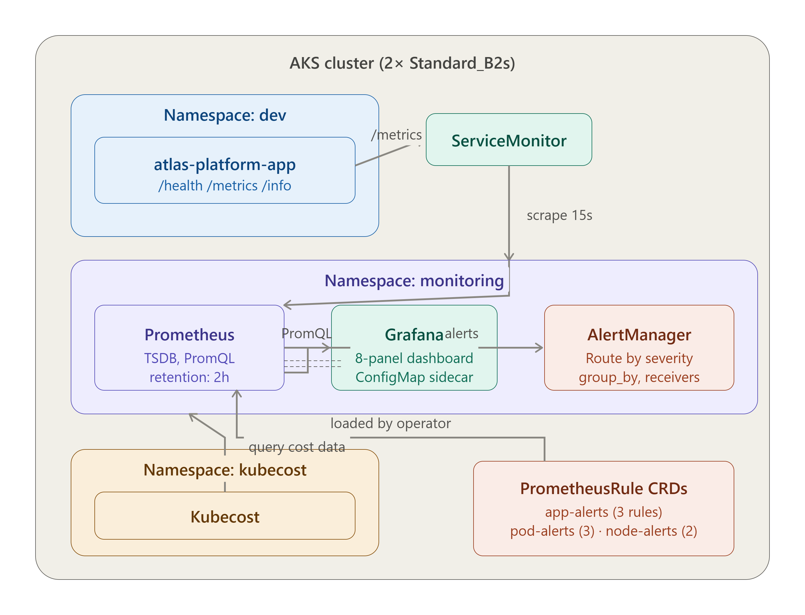
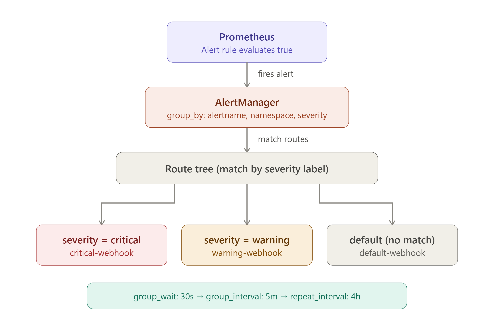
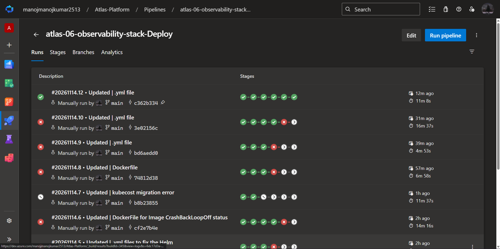
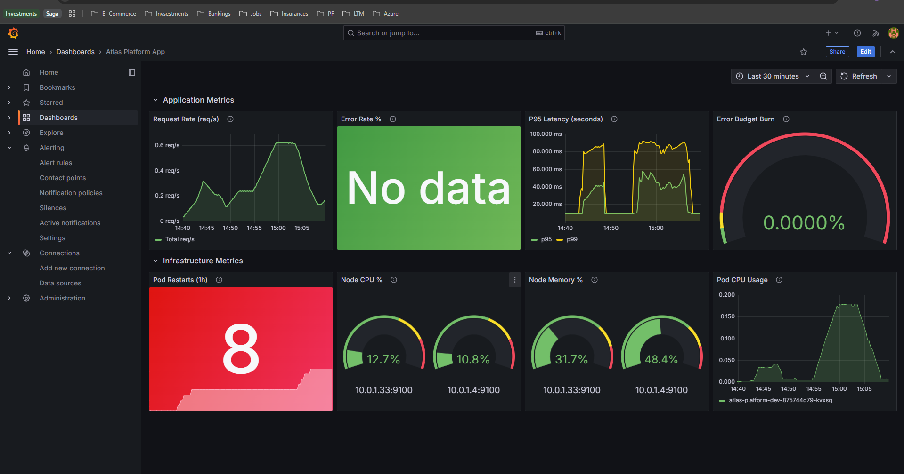
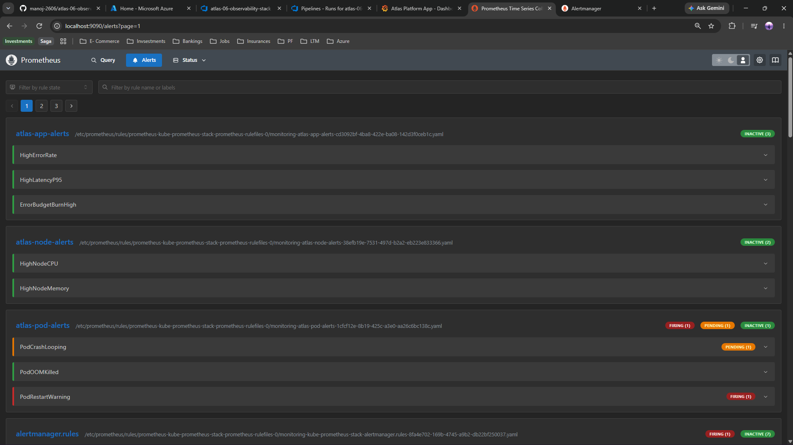
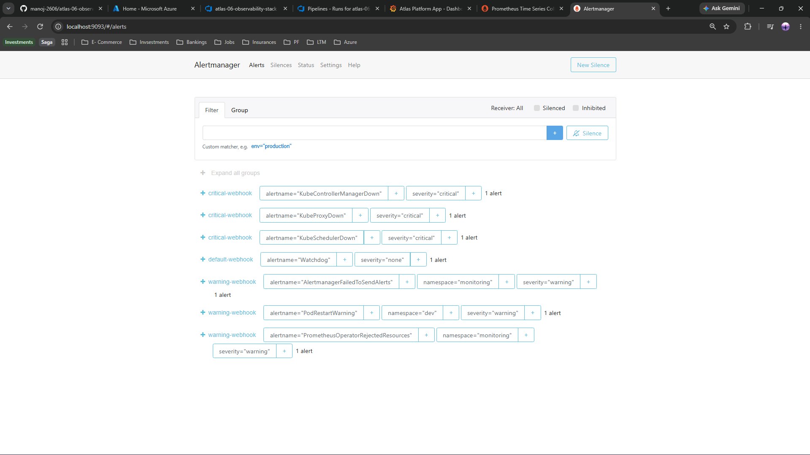
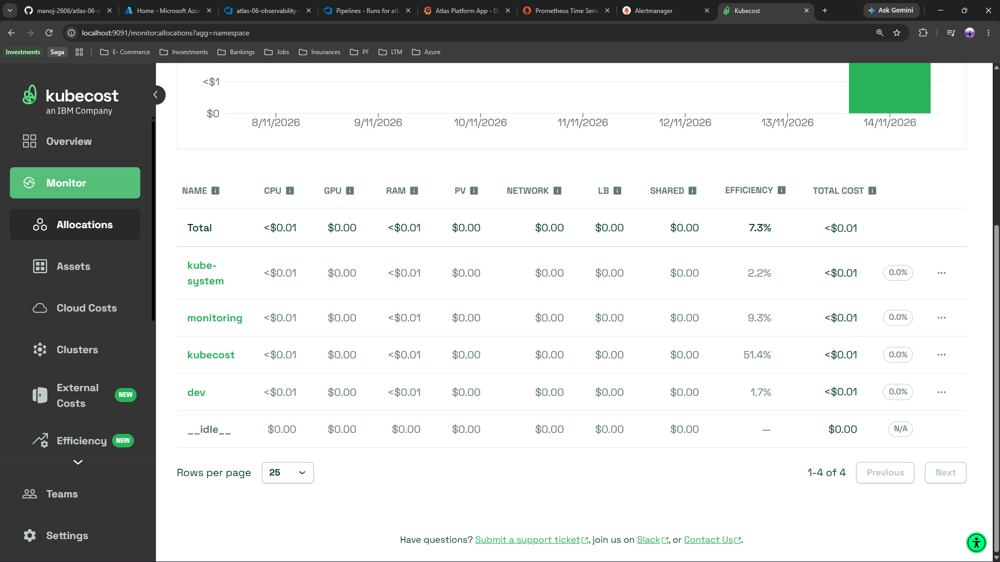
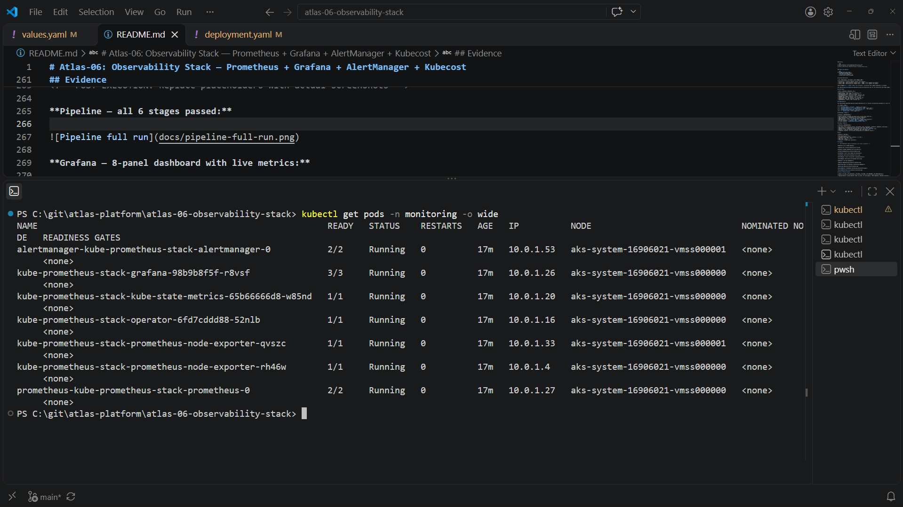
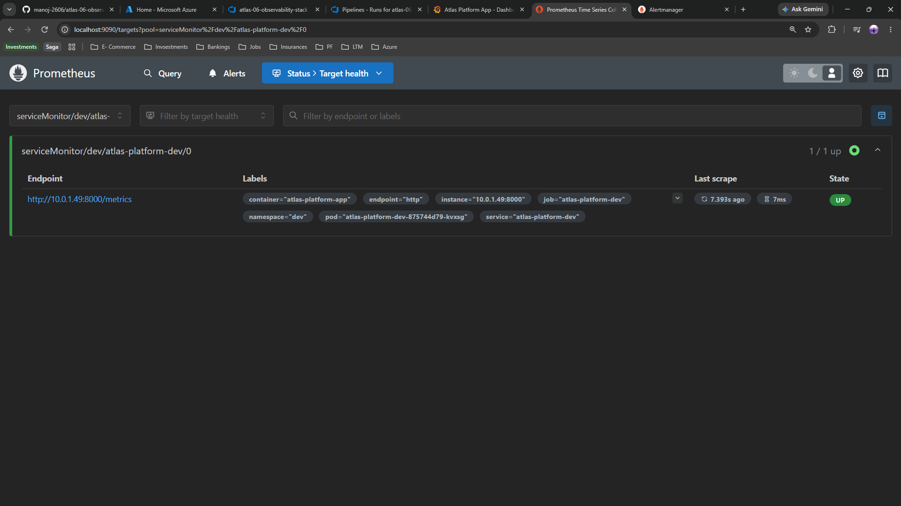

# Atlas-06: Observability Stack — Prometheus + Grafana + AlertManager + Kubecost

> **Project 6 of 11** in the [Atlas Platform Portfolio](https://github.com/manoj-2606) — a production-grade Azure cloud engineering portfolio targeting Senior DevOps/Platform Engineer roles in Europe.

## Problem

Deploying applications without observability is flying blind. Most teams discover outages from user complaints, not monitoring. Without SLIs and SLOs, there's no objective measure of reliability — "it feels slow" replaces "p95 latency breached 200ms for 3 minutes."

Common gaps in production monitoring:
- No custom metrics — relying only on node-level CPU/memory, blind to application behavior
- No defined SLOs — no agreement on what "reliable enough" means
- Alert fatigue — too many alerts, wrong thresholds, no severity routing
- No cost visibility — no idea which workload costs what
- Dashboards built manually in UI — unreproducible, lost on cluster rebuild

## Solution

This project deploys a full observability stack on AKS:

- **Prometheus** scrapes custom `/metrics` from the app via ServiceMonitor CRDs
- **Grafana** displays 8-panel dashboard provisioned as code (ConfigMap sidecar)
- **AlertManager** routes alerts by severity to different receivers
- **Kubecost** provides cost-per-namespace visibility (FinOps)
- **SLI/SLO** defined with error budget burn rate tracking

Everything is deployed via Helm, configured in YAML, and destroyed same day. The monitoring stack itself is the deliverable — the pipeline is intentionally simple.

## Architecture

### Observability Data Flow



```
atlas-platform-app (/metrics)
        │
        ▼ ServiceMonitor (scrape every 15s)
   ┌─────────────┐
   │  Prometheus  │──── PromQL queries ───→ Grafana (8-panel dashboard)
   │  (TSDB)      │
   │              │──── Alert rules ──────→ AlertManager ──→ Webhook receivers
   └──────────────┘                           │
        │                                     ├─ critical → critical-webhook
        │                                     ├─ warning  → warning-webhook
        ▼                                     └─ default  → default-webhook
   ┌──────────┐
   │ Kubecost │ (cost per namespace/pod — FinOps)
   └──────────┘
```

### Alert Routing



### Infrastructure

| Component | Sizing | Why |
|-----------|--------|-----|
| AKS | 2× Standard_B2s (8GB total) | Monitoring stack needs ~2.1GB RAM — single B2s can't fit it |
| Prometheus | 512Mi request, 768Mi limit | Time-series DB is memory-intensive |
| Grafana | 128Mi request, 256Mi limit | Dashboard rendering |
| AlertManager | 64Mi request, 128Mi limit | Lightweight routing engine |
| Kubecost | 128Mi request, 256Mi limit | Cost model calculation |
| atlas-platform-app | 128Mi request, 256Mi limit | The workload being observed |
| ACR | Basic SKU | Image storage |

## Repo Structure

```
atlas-06-observability-stack/
├── terraform/
│   ├── main.tf                          # atlas-infra-base module (2× B2s)
│   ├── variables.tf
│   ├── outputs.tf
│   └── environments/
│       └── dev.tfvars                   # 2 nodes, K8s 1.37.1, cost tags
│
├── Dockerfile                           # Multi-stage, non-root, <100MB
│
├── charts/
│   └── atlas-platform/                  # App Helm chart
│       ├── Chart.yaml
│       ├── values.yaml
│       └── templates/
│           ├── _helpers.tpl
│           ├── deployment.yaml
│           ├── service.yaml
│           ├── configmap.yaml
│           └── servicemonitor.yaml      # ★ Prometheus scraping config
│
├── monitoring/
│   ├── prometheus-stack-values.yaml     # ★ kube-prometheus-stack overrides
│   ├── kubecost-values.yaml             # ★ Kubecost overrides
│   ├── alerts/
│   │   ├── app-alerts.yaml              # ★ Error rate, latency, burn rate
│   │   ├── pod-alerts.yaml              # ★ CrashLoop, OOMKill, restarts
│   │   └── node-alerts.yaml             # ★ Node CPU, memory
│   ├── dashboards/
│   │   └── atlas-app-dashboard.json     # ★ Grafana dashboard as code
│   └── slo/
│       └── slo-definition.md            # ★ SLI/SLO/Error Budget
│
├── scripts/
│   ├── generate-load.sh                 # Populate metrics for demo
│   └── trigger-failure.sh               # Test alert rules
│
├── azure-pipelines.yml                  # Deploy (inline AzureCLI bash)
├── azure-pipelines-destroy.yml          # Destroy (approval gate)
│
├── docs/
│   ├── architecture.png
│   ├── alertmanager-routing.png
│   ├── grafana-dashboard.png            # Screenshot after deployment
│   ├── kubecost-namespace.png           # Screenshot after deployment
│   └── promql-cheatsheet.md             # 5 queries with full explanation
│
├── .pre-commit-config.yaml
├── .gitignore
└── README.md
```

## How to Run

### Prerequisites
- Azure subscription with Contributor access
- Azure DevOps project `Atlas-Platform` with `MI-ADO-API` service connection
- Terraform state backend: `atlastfstate2606` in `rg-atlas-tfstate`
- `atlas-platform-app` repo in ADO (multi-repo checkout)

### Deploy

```bash
# 1. Push code to ADO
git remote add ado https://dev.azure.com/manojmanojkumar2513/Atlas-Platform/_git/atlas-06-observability-stack
git push ado main

# 2. Set ADO repo permissions (Build Service → Contribute + Bypass)

# 3. Create environments: atlas-06-deploy (no approval), atlas-06-destroy (approval)

# 4. Create pipeline → azure-pipelines.yml → Run
#    Stage 1: Bootstrap (tfstate storage)
#    Stage 2: Infrastructure (Terraform → AKS 2 nodes + ACR)
#    Stage 3: Build (Docker → Trivy → SBOM → ACR push)
#    Stage 4: Deploy App (Helm install atlas-platform-app)
#    Stage 5: Deploy Monitoring (Prometheus + Kubecost + alerts + dashboard)
#    Stage 6: Verify (all pods Running, ServiceMonitor exists, rules applied)
```

### Manual Verification (after pipeline completes)

```bash
# Get AKS credentials
az aks get-credentials --resource-group rg-atlas-06-dev --name aks-atlas-06-dev

# Access Grafana
kubectl port-forward svc/kube-prometheus-stack-grafana 3000:80 -n monitoring
# Open http://localhost:3000 — login: admin / atlas-admin

# Generate metrics for dashboard
./scripts/generate-load.sh

# Test alert rules
./scripts/trigger-failure.sh

# Access Prometheus UI
kubectl port-forward svc/kube-prometheus-stack-prometheus 9090:9090 -n monitoring

# Access AlertManager
kubectl port-forward svc/kube-prometheus-stack-alertmanager 9093:9093 -n monitoring

# Access Kubecost
kubectl port-forward svc/kubecost-cost-analyzer 9090:9090 -n kubecost
```

### Destroy

```bash
# Create pipeline → azure-pipelines-destroy.yml → Run
# Requires approval on atlas-06-destroy environment
# Verify: Azure Portal → Resource Groups → rg-atlas-06-dev gone
```

### State Lock Recovery

```bash
az storage blob lease break \
  --blob-name atlas-06.tfstate \
  --container-name tfstate \
  --account-name atlastfstate2606
```

## SLI/SLO Definitions

| SLI | Measurement | SLO Target | Error Budget (30d) |
|-----|------------|------------|-------------------|
| Availability | % non-5xx requests | 99.9% | 43.2 minutes |
| Latency (p95) | 95th percentile response time | < 200ms | 5% of requests can exceed |
| Latency (p99) | 99th percentile response time | < 500ms | 1% of requests can exceed |

**Error Budget:** `1 - 0.999 = 0.001 = 43.2 min/month`. At 10x burn rate, budget exhausted in ~4 minutes.

See [monitoring/slo/slo-definition.md](monitoring/slo/slo-definition.md) for full definitions and PromQL mappings.

## Alert Rules

| Alert | Condition | Severity | For |
|-------|-----------|----------|-----|
| HighErrorRate | Error rate > 1% | critical | 2m |
| HighLatencyP95 | P95 > 500ms | warning | 2m |
| ErrorBudgetBurnHigh | Burn rate > 0.001 | warning | 5m |
| PodCrashLooping | > 3 restarts in 15m | critical | 1m |
| PodOOMKilled | OOMKill detected | critical | 0m |
| PodRestartWarning | Any restart in 1h | warning | 5m |
| HighNodeCPU | CPU > 80% sustained | warning | 5m |
| HighNodeMemory | Memory > 85% | warning | 5m |

## PromQL Queries

See [docs/promql-cheatsheet.md](docs/promql-cheatsheet.md) for 5 queries with detailed explanation of every function, label, and time window.

| # | Query | Shows |
|---|-------|-------|
| 1 | `rate(http_requests_total[5m])` | Requests per second |
| 2 | `sum(rate({status=~"5.."})) / sum(rate(total)) * 100` | Error rate % |
| 3 | `histogram_quantile(0.95, sum(rate(bucket)) by (le))` | P95 latency |
| 4 | `increase(restarts_total[1h])` | Pod restarts |
| 5 | `1 - (success_rate)` | Error budget burn |

## DevSecOps — Baked In

| Practice | Implementation |
|----------|---------------|
| Secrets scanning | gitleaks pre-commit hook — secrets never reach Git |
| OIDC authentication | MI-ADO-API — zero stored credentials |
| Image scanning | Trivy — zero CRITICAL CVEs reach ACR |
| SBOM generation | `trivy --format spdx-json` — supply chain visibility |
| Non-root containers | `runAsUser: 1000`, `runAsNonRoot: true` |
| SA token disabled | `automountServiceAccountToken: false` |

## FinOps — Baked In

| Practice | Implementation |
|----------|---------------|
| Cost tags | Every resource: project, environment, team, cost-center, created-by, managed-by, destroy-by |
| Right-sizing | 2× Standard_B2s (not D-series), Basic ACR, 30GB OS disks |
| Ephemeral infra | Created and destroyed same day — `destroy-by: end-of-day` tag |
| Kubecost | ★ Cost per namespace, deployment, pod — K8s FinOps tool |
| Prometheus retention | 2h — no point storing metrics on ephemeral clusters |

## Cost

| Resource | Cost/Day |
|----------|----------|
| AKS control plane | Free |
| 2× Standard_B2s nodes | ~₹7 (~$0.04/hr × 2 × 8hr) |
| ACR Basic | ~₹14 (~$0.17/day) |
| VNet / NSG | Free |
| **Total** | **~₹60-70 per execution** |

## Evidence

<!-- POST-EXECUTION: Replace placeholders with actual screenshots -->

**Pipeline — all 6 stages passed:**



**Grafana — 8-panel dashboard with live metrics:**



**Prometheus — alert rules loaded and evaluating:**



**AlertManager — alerts firing after /simulate/failure:**



**Kubecost — cost per namespace:**



**Monitoring pods — all Running in monitoring namespace:**



**ServiceMonitor — Prometheus discovering atlas-platform-app:**



## Versus Previous Projects

| Aspect | P1 (IaC) | P2 (Container) | P3 (Helm) | P4 (ADO) | P5 (GHA+OIDC) | P6 (Observability) |
|--------|----------|----------------|-----------|----------|---------------|-------------------|
| Pipeline Pattern | Inline Bash+PS | Bash .sh files | PS .ps1 engines | YAML templates | Reusable workflows | **Inline AzureCLI bash** |
| AKS Nodes | 1 | 0 (ACR only) | 1 | 1 | 1 | **2** (monitoring needs RAM) |
| Monitoring | None | None | None | None | None | **Full stack** |
| Alerting | None | None | None | None | None | **8 PrometheusRules** |
| Dashboard | None | None | None | None | None | **Grafana as code** |
| SLI/SLO | None | None | None | None | None | **Defined + tracked** |
| Cost Visibility | Tags only | Tags only | Tags only | Tags only | Tags only | **Tags + Kubecost** |
| New CRDs | None | None | None | None | None | **ServiceMonitor, PrometheusRule** |

## Lessons Learned

| # | Stage | Error | Root Cause | Fix | Time Lost |
|---|-------|-------|------------|-----|-----------|
| | | | | | |

<!-- Fill after execution -->

## Interview Summary

### Primary Story — SRE / Observability
*"I define SLIs, set SLOs, calculate error budget burn rate, and build alerting that routes to the right team. I can show you a Grafana dashboard with 5 custom PromQL queries, PrometheusRule alert definitions, and an AlertManager routing config — all deployed on AKS with kube-prometheus-stack."*

### Secondary Story — FinOps Visibility
*"I use Kubecost to see cost per namespace and deployment. I can tell you which microservice costs the most and whether it's justified by the traffic it handles. Cost is a first-class metric alongside latency and error rate."*

### Questions This Project Answers
- What is the difference between SLI, SLO, SLO target, and error budget?
- Write a PromQL query for error rate / p95 latency / burn rate
- How does Prometheus service discovery work in Kubernetes?
- What is a ServiceMonitor and why use it over annotations?
- How does AlertManager route alerts to different receivers?
- What is `group_by`, `group_wait`, `group_interval` in AlertManager?
- How do you provision Grafana dashboards as code?
- What does Kubecost measure and how does it calculate pod cost?
- How do you size Prometheus for production?
- What's the difference between recording rules and alerting rules?

## Related Projects

| Project | Focus | Repo |
|---------|-------|------|
| P1 — IaC Foundation | Terraform + AKS from scratch | [atlas-01-iac-foundation](https://github.com/manoj-2606/atlas-01-iac-foundation) |
| P2 — Container Security | Docker + Trivy + SBOM | [atlas-02-container-security](https://github.com/manoj-2606/atlas-02-container-security) |
| P3 — Helm Deployment | Helm charts + AKS deployment | [atlas-03-helm-deployment](https://github.com/manoj-2606/atlas-03-helm-deployment) |
| P4 — Pipeline Mastery | YAML templates + multi-env CI/CD (ADO) | [atlas-04-pipeline-mastery-ado](https://github.com/manoj-2606/atlas-04-pipeline-mastery-ado) |
| P5 — GHA + OIDC | GitHub Actions + OIDC Federation | [atlas-05-gha-oidc](https://github.com/manoj-2606/atlas-05-gha-oidc) |
| **P6 — Observability** | **Prometheus + Grafana + Kubecost + SLO** | **atlas-06-observability-stack** |

---

**Built by [Manoj Kumar R](https://github.com/manoj-2606) — Atlas Platform Portfolio**
**Target: Senior DevOps / Platform Engineer — Netherlands | Finland | Sweden | Ireland**